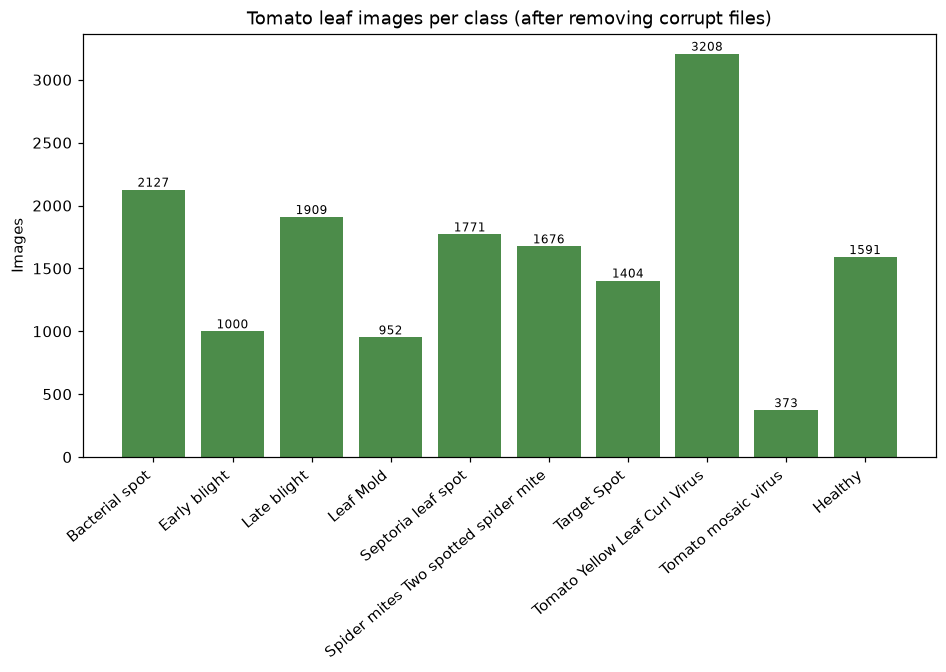
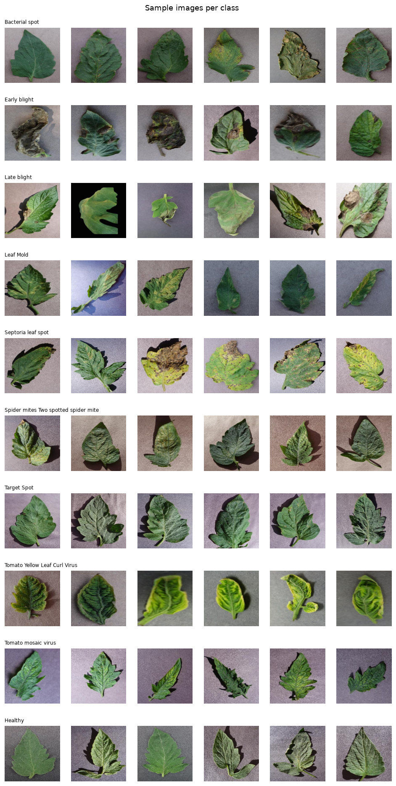
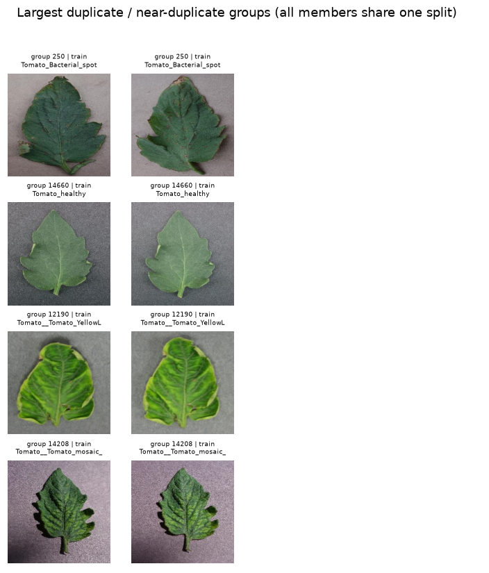
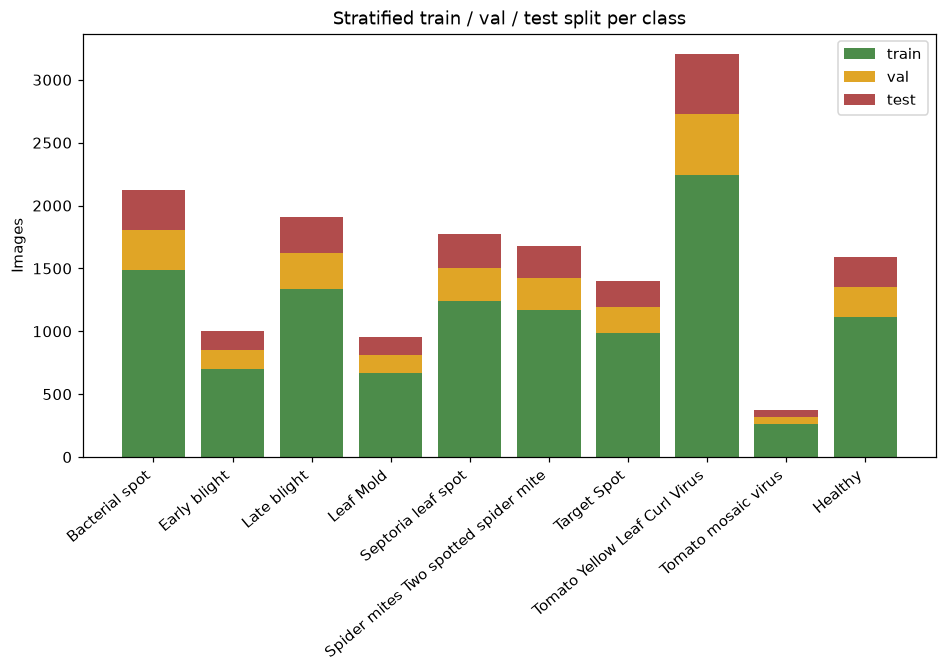
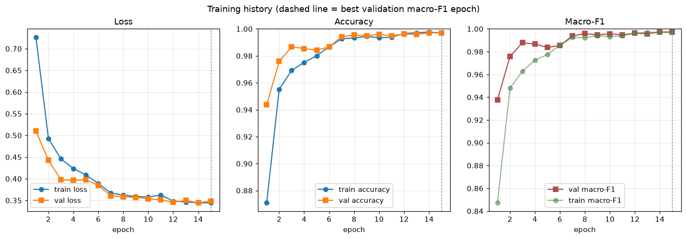
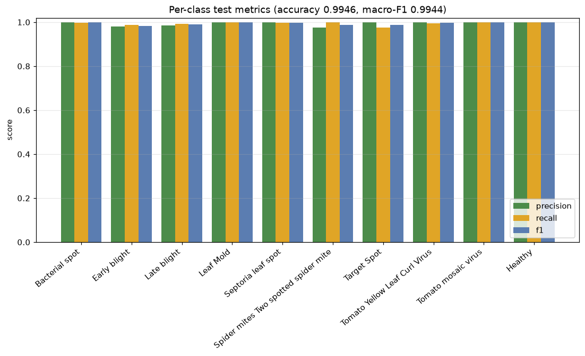
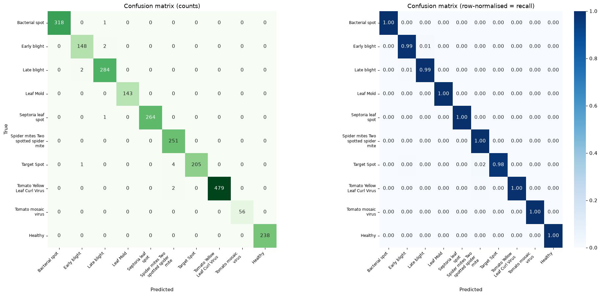
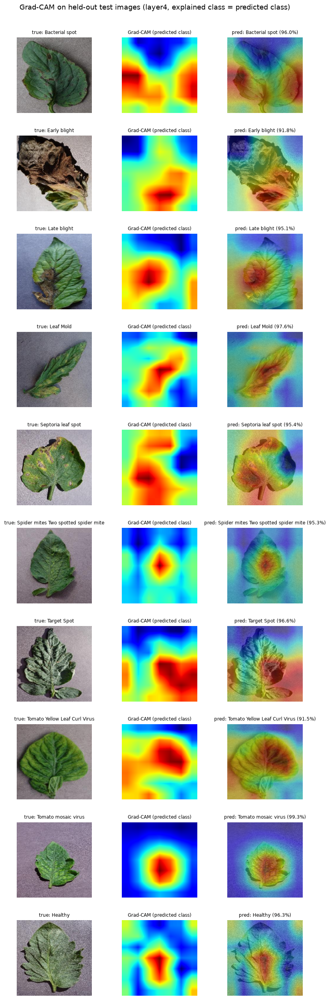
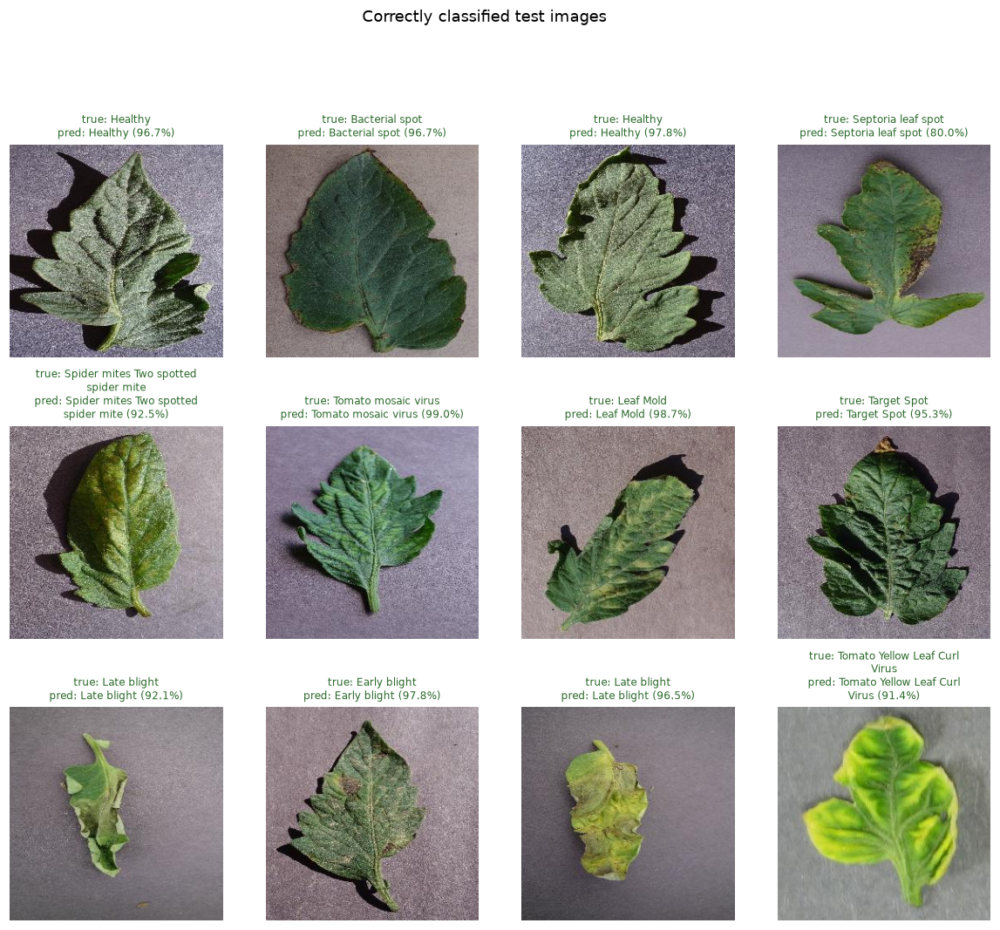
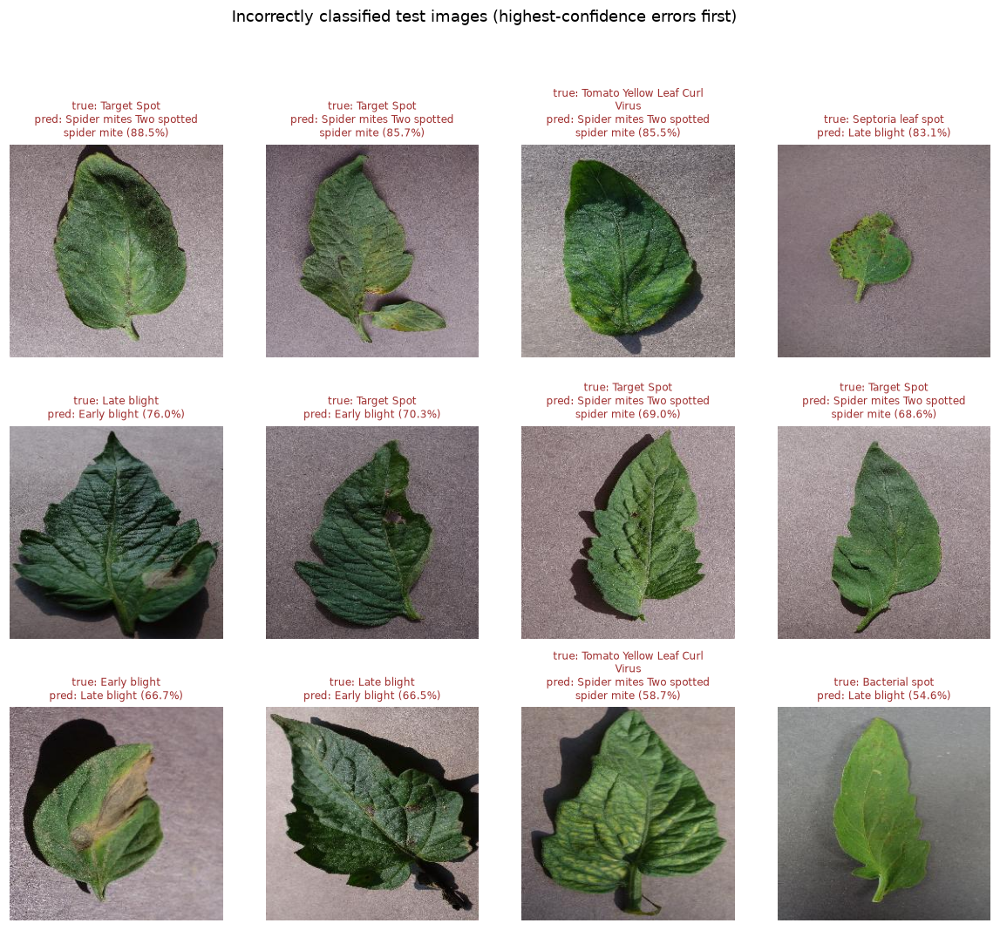

# Tomato Leaf Disease Detection with a ResNet18 Feature Extractor, an MLP Classification Head and Grad-CAM Explanations

**Project report.** PyTorch implementation contained in this repository (`src/`, `app.py`, `notebooks/`).

> **How to read this report.** Sections 5–12 describe the data and the method; every number in them is taken from the source code or from files written by the pipeline (`data/processed/dataset_source.json`, `results/dataset_summary.json`, `data/splits/split_summary.json`, `data/processed/image_index_clean.csv`, `results/model_summary.txt`, `results/training_log.txt`), or is derived from those numbers with the derivation shown. Measured outcomes of the experiment appear only in the Abstract, Section 11.5, Sections 13–16 and the Conclusion. Paragraphs marked **Expected behaviour** are hypotheses stated before the results were examined, not measurements.

---

## 1 Abstract

Foliar diseases and pests of tomato leave visible symptoms on leaves, which makes image-based screening possible. This report describes a classifier for ten tomato leaf conditions (nine diseases or pest disorders plus healthy leaves) together with a visual explanation of every prediction. The data are the 16,011 tomato images of the Kaggle "PlantVillage Dataset" (`emmarex/plantdisease`), a redistribution of the PlantVillage collection of Hughes and Salathé [1]. Every image was integrity-checked. Exact duplicates (identical MD5 digests) and near-duplicates (64-bit difference hashes within Hamming distance 4) were merged into 34 groups covering 68 images. A stratified group split then placed each group in exactly one of the training (11,208 images), validation (2,404) and test (2,399) subsets, and an automatic check found no shared file, group or hash between any two subsets. The model is an ImageNet-pretrained ResNet18 convolutional trunk [3, 5], of which only the last two residual stages are fine-tuned, followed by global average pooling and a multilayer-perceptron (MLP) head (512 → 256 → 10). It has 11,310,410 parameters, of which 10,627,338 are trainable. Training used AdamW [6] with separate learning rates for the backbone and the head, cross-entropy with inverse-square-root class weights and label smoothing [8], a reduce-on-plateau learning-rate schedule, and early stopping on validation macro-F1. It ran on an Apple M5 GPU through the PyTorch MPS backend [7]. The checkpoint selected at epoch 15 (of 15 epochs run) was evaluated once on the 2399 held-out test images. It reached an accuracy of 0.9946, macro-precision 0.9943, macro-recall 0.9945, macro-F1 0.9944 and weighted F1 0.9946, and misclassified 13 test images. Grad-CAM [4] on the last convolutional stage gives class-discriminative attribution maps; a local Gradio application shows them next to the class probabilities. PlantVillage photographs were taken under controlled conditions, so these figures measure performance on data like the training data. They are not estimates of accuracy in the field.

## 2 Introduction

Tomato plants are affected by bacterial, fungal, oomycete and viral diseases and by arthropod pests, many of which first appear as characteristic leaf symptoms: water-soaked or necrotic spots, concentric-ring lesions, blights, mould growth, mosaic mottling, leaf curling or stippling. Expert visual diagnosis is accurate but not always available, which motivates automatic, image-based screening tools that can run on ordinary hardware.

Open data made this line of work practical. Hughes and Salathé [1] released PlantVillage, an open-access repository of leaf images of healthy and diseased crops, explicitly to support mobile disease diagnostics. Mohanty, Hughes and Salathé [2] showed that deep convolutional neural networks (CNNs) trained on this collection classify crop–disease pairs with high accuracy on held-out PlantVillage images. They also noted that accuracy fell substantially on images taken under different conditions, a caveat this report returns to in Section 17.

Two further ideas shape the method. First, *transfer learning*: a CNN pretrained on ImageNet [5] already has general-purpose visual features, so a comparatively small labelled dataset is enough to adapt it. Residual networks [3] are a standard, well-understood choice, and ResNet18 is small enough to fine-tune on a laptop GPU. Second, *explainability*: a high accuracy number does not show what evidence the network relies on. Gradient-weighted Class Activation Mapping (Grad-CAM) [4] produces a coarse heat map of the image regions that raised the score of a chosen class, which helps to spot implausible reasoning, for example attention on the background.

This project contributes:

1. a reproducible data pipeline that downloads the data, records its provenance, discovers classes from folder names, checks image integrity, groups exact and near-duplicates, and builds a stratified, leakage-free train/validation/test split that is verified automatically;
2. a compact CNN-feature-extractor + MLP classifier, with documented tensor shapes and parameter counts, trained on an Apple-silicon laptop;
3. an evaluation protocol that accounts for class imbalance: macro and weighted precision, recall and F1, per-class metrics, a confusion matrix and inspection of errors;
4. a Grad-CAM implementation with automatic sanity checks; and
5. inference tools: a command-line predictor and a Gradio web application with a non-diagnostic disclaimer.

Sections 3–4 state the problem and the objectives, Sections 5–7 describe the data and its preprocessing, Sections 8–10 describe the model and its training, Sections 11–12 give the experimental setup and the metrics, Sections 13–16 report and analyse the results, and Sections 17–20 cover limitations, future work, conclusions and references.

## 3 Problem Statement

Let $x \in \mathbb{R}^{3 \times H \times W}$ be an RGB photograph of a single tomato leaf and let $\mathcal{C} = \{0, \dots, K-1\}$ with $K = 10$ be the set of leaf conditions listed in Section 6. The task is single-label, closed-set image classification. We learn a function $f_\theta$ whose softmax output $p = \mathrm{softmax}(f_\theta(x)) \in \Delta^{K-1}$ is a probability vector over $\mathcal{C}$, and we predict $\hat{y} = \arg\max_c p_c$.

The solution has to meet four requirements:

1. **Honest generalisation estimate.** No image, and no exact or near-identical copy of an image, may appear in more than one of the training, validation and test subsets. Otherwise test accuracy partly measures memorisation.
2. **Class imbalance.** The largest class (Tomato Yellow Leaf Curl Virus, 3,208 images) is 8.6 times the size of the smallest (Tomato mosaic virus, 373 images). Training and model selection must not be dominated by the large classes.
3. **Explainability.** Every prediction should come with a visual indication of the image regions that drove it.
4. **Practicality.** Training and inference must run locally on a laptop (Apple M5, 16 GB RAM) without cloud resources.

The following are explicitly **out of scope**: pixel-accurate lesion segmentation, disease-severity estimation, leaves with several simultaneous conditions, photographs of whole plants or field scenes, and inputs that are not tomato leaves.

## 4 Objectives

1. Acquire the dataset reproducibly and record its provenance and scope (Section 5).
2. Audit the data: integrity, image properties, class balance, and exact and near-duplicates (Sections 5–7).
3. Build a stratified 70 / 15 / 15 train/validation/test split that keeps every duplicate group inside one subset, and verify it automatically (Section 7).
4. Implement a CNN feature extractor followed by an MLP classification head, and document its tensor shapes and parameter counts (Sections 8–9).
5. Train with an imbalance-aware loss, select the model on validation macro-F1, and stop early when validation performance plateaus (Section 10).
6. Evaluate the selected model **once** on the untouched test subset using accuracy, macro and weighted precision/recall/F1, per-class metrics, a confusion matrix and example errors (Sections 12–14, 16).
7. Explain predictions with Grad-CAM and check the explanation maps automatically (Section 15).
8. Provide inference tools (command-line predictor and Gradio app) that show the prediction, all class probabilities, the Grad-CAM heat map and a disclaimer.

## 5 Dataset Description and Source

### 5.1 Source and provenance

**Table 5.1 – Dataset provenance** (from `src/download.py` and `data/processed/dataset_source.json`).

| Item | Value |
|---|---|
| Dataset title (Kaggle) | "PlantVillage Dataset" |
| Kaggle slug | `emmarex/plantdisease` |
| URL | https://www.kaggle.com/datasets/emmarex/plantdisease |
| Uploader | Tairu Oluwafemi Emmanuel |
| Licence shown on Kaggle | "Unknown" |
| Upstream source | The uploader credits the GitHub repository `spMohanty/PlantVillage-Dataset`, which redistributes the PlantVillage images of Hughes and Salathé [1] |
| Download method | `kagglehub.dataset_download` (public dataset, no Kaggle credentials used) |
| Local cache | `data/raw/kagglehub_cache/datasets/emmarex/plantdisease/versions/1` |
| Class root used | `.../versions/1/PlantVillage` |
| Provenance record | `data/processed/dataset_source.json` (slug, URL, uploader, licence as listed on Kaggle "checked 2026-11-03", upstream repository, original publication, usage note) |

### 5.2 Archive structure and scope

The downloaded archive contains a `PlantVillage/` directory with class folders for pepper, potato and tomato leaves, and a second, identical copy nested at `PlantVillage/PlantVillage/`. The function `find_class_root` walks the archive and selects the **shallowest** directory that contains `Tomato*` sub-folders, so only the outer copy is indexed. Indexing both copies would put every image in the dataset twice.

Only folders whose names begin with `Tomato` are used; the pepper and potato folders are excluded. Class names are **discovered at run time** from the folder names (`discover_tomato_classes`), never hard-coded. Sorting the folder names alphabetically fixes the label indices (Table 6.1). The mapping is stored in `models/class_mapping.json` and embedded in every checkpoint, so training, evaluation and the app share it. There are 10 tomato folders.

### 5.3 Image properties

**Table 5.2 – Image-level statistics** (from `results/dataset_summary.json`).

| Property | Value |
|---|---|
| Image files indexed | 16,011 |
| Corrupt or unreadable images | 0 |
| Non-image files skipped | 1 (an extension-less file `svn-r6Yb5c` in the Tomato Yellow Leaf Curl Virus folder, listed in `data/processed/skipped_files.json`) |
| Usable images | 16,011 |
| File format | JPEG (all 16,011) |
| Colour mode | RGB (all 16,011) |
| Resolution | 256 × 256 pixels (all 16,011) |
| File size (min / median / max) | 3,440 / 16,389 / 28,770 bytes |
| Number of classes | 10 |
| Imbalance ratio (largest / smallest class) | 8.6 |

The images show single detached leaves photographed on plain, uniform backgrounds. The app's disclaimer in `src/disease_info.py` describes them as "lab-style photos on plain backgrounds", and Figures 5.2 and 7.1 show the same. This uniformity simplifies classification, but it also limits how far results transfer to field photographs (Section 17).

### 5.4 Class distribution

The class counts and shares are listed in Table 6.1. Tomato Yellow Leaf Curl Virus holds 20.0% of the images and Tomato mosaic virus 2.3%; the other eight classes hold between 5.9% and 13.3% each.



*Figure 5.1 – Number of usable images per class (`results/plots/class_distribution.png`).*



*Figure 5.2 – Six randomly drawn images per class (`results/plots/sample_images.png`, generated by `src/explore.py`).*

The distribution of image resolutions is plotted in `results/plots/image_dimensions.png`; it has a single bar, because every image is 256 × 256.

## 6 Disease Classes

**Table 6.1 – Classes, label indices and image counts** (from `results/dataset_summary.json` and `results/dataset_summary.md`; shares are rounded to one decimal).

| Label | Folder name | Display name | Images | Share |
|---:|---|---|---:|---:|
| 0 | `Tomato_Bacterial_spot` | Bacterial spot | 2,127 | 13.3% |
| 1 | `Tomato_Early_blight` | Early blight | 1,000 | 6.2% |
| 2 | `Tomato_Late_blight` | Late blight | 1,909 | 11.9% |
| 3 | `Tomato_Leaf_Mold` | Leaf Mold | 952 | 5.9% |
| 4 | `Tomato_Septoria_leaf_spot` | Septoria leaf spot | 1,771 | 11.1% |
| 5 | `Tomato_Spider_mites_Two_spotted_spider_mite` | Spider mites Two spotted spider mite | 1,676 | 10.5% |
| 6 | `Tomato__Target_Spot` | Target Spot | 1,404 | 8.8% |
| 7 | `Tomato__Tomato_YellowLeaf__Curl_Virus` | Tomato Yellow Leaf Curl Virus | 3,208 | 20.0% |
| 8 | `Tomato__Tomato_mosaic_virus` | Tomato mosaic virus | 373 | 2.3% |
| 9 | `Tomato_healthy` | Healthy | 1,591 | 9.9% |
| | **Total** | | **16,011** | **100%** |

Display names are generated from folder names by `display_name()` in `src/dataset.py`. The function removes the `Tomato_` / `Tomato__` prefix, turns underscores into spaces, splits CamelCase words (for example `YellowLeaf` becomes "Yellow Leaf") and maps `healthy` to "Healthy". Healthy has label 9, not 0, because the folder names are sorted case-sensitively and the lowercase `h` sorts after the underscore.

**Table 6.2 – Background on each class.** The texts are condensed from the short, non-diagnostic descriptions that the application displays (`src/disease_info.py`).

| Display name | Type | Causal agent | Typical visible leaf symptoms |
|---|---|---|---|
| Bacterial spot | Bacterial | *Xanthomonas* spp. | Small dark, water-soaked spots, sometimes with yellow halos |
| Early blight | Fungal | *Alternaria solani* | Brown lesions with concentric "target-like" rings, usually on older, lower leaves first |
| Late blight | Oomycete | *Phytophthora infestans* | Large irregular grey-green to brown blotches, often with pale edges |
| Leaf Mold | Fungal | *Passalora fulva* | Pale yellow patches on the upper surface, olive-green to brown mould underneath |
| Septoria leaf spot | Fungal | *Septoria lycopersici* | Many small circular spots with dark borders and light centres |
| Spider mites Two spotted spider mite | Pest (arthropod) | *Tetranychus urticae* | Fine stippling, yellowing or bronzing, sometimes fine webbing |
| Target Spot | Fungal | *Corynespora cassiicola* | Brown spots with concentric rings; can resemble early blight |
| Tomato Yellow Leaf Curl Virus | Viral | Whitefly-transmitted virus | Upward curling and yellowing of leaf margins, stunting |
| Tomato mosaic virus | Viral | Tomato mosaic virus | Light/dark green mottling (mosaic), leaf distortion |
| Healthy | — | — | No visible symptoms |

The class set therefore mixes disease categories: one bacterial disease, four fungal diseases, one oomycete disease, one pest disorder, two viral diseases and healthy leaves. Some pairs share visual traits, notably the concentric rings of Early blight and Target Spot and the small dark spots of Bacterial spot and Septoria leaf spot. Section 14 discusses these as likely sources of confusion.

## 7 Data Preprocessing

Preprocessing is implemented in `src/dataset.py` (indexing, duplicates, splitting), `src/explore.py` (statistics and plots) and `src/preprocessing.py` (tensor transforms). It runs with `python -m src.dataset` followed by `python -m src.explore`.

### 7.1 Indexing and integrity checks

Every file with an image extension (`.jpg .jpeg .png .bmp .tif .tiff .webp`, case-insensitive) in the ten class folders is analysed by a pool of worker processes (8 by default). For each file `analyze_image`:

1. computes the MD5 digest of the raw bytes;
2. runs `PIL.Image.verify()` to detect truncated or malformed files;
3. reopens and fully decodes the image (`load()`), recording format, colour mode, width, height and file size;
4. computes a 64-bit difference hash (dHash, Section 7.2) of the grey-scale image.

Any exception (`UnidentifiedImageError`, `OSError`, `SyntaxError`, `ValueError`) marks the record as unusable. Files without an image extension are skipped and listed in `skipped_files.json`. The full index, including any failures, is written to `data/processed/image_index.csv`; the cleaned index with duplicate groups and split assignments is written to `data/processed/image_index_clean.csv`. On this dataset no image failed and one non-image file was skipped (Table 5.2).

### 7.2 Exact and near-duplicate detection

Public image collections often contain repeated photographs, either as byte-identical copies or as copies that were re-encoded, resized or slightly re-exposed. If such copies end up on both sides of the train/test boundary, the test score is inflated. Duplicates are therefore detected in two ways.

**Exact duplicates.** Two files are exact duplicates when their MD5 digests are identical.

**Near-duplicates.** For each image, the grey-scale version is resized to 9 × 8 pixels (width × height, Lanczos resampling). Each of the 8 rows gives 8 bits, one per pair of horizontally adjacent pixels, so the hash has 64 bits:

```math
b_{r,c} = \mathbb{1}\left[\, g_{r,c+1} > g_{r,c} \,\right], \qquad r = 1,\dots,8,\; c = 1,\dots,8
```

The distance between two hashes is the Hamming distance, the number of differing bits:

```math
d(h_i, h_j) = \operatorname{popcount}(h_i \oplus h_j)
```

Two images are near-duplicates when $d(h_i, h_j) \le 4$, that is, when at most 4 of the 64 bits (6.25%) differ (`DHASH_HAMMING_THRESHOLD = 4`). dHash depends only on the relative brightness of neighbouring pixels in a heavily downsampled image. It is therefore robust to re-compression, rescaling and global brightness changes, but not to rotation, mirroring or substantial cropping. All pairs of images are compared, in blocks of 512 rows, using vectorised XOR and bit counting.

**Grouping.** Each image is a node in a graph. An edge joins two images when they share an MD5 digest or when their dHash distance is at most 4. A union–find (disjoint-set) structure with path halving merges the endpoints of every edge, and each resulting connected component becomes a **duplicate group** (`group_id`). Because grouping is transitive, a chain A ≈ B ≈ C forms one group even when A and C are further apart than the threshold. This is the conservative choice when the goal is to prevent leakage. Images are flagged `exact_dup` when they share an MD5 with another image and `near_dup` when they are only near-duplicates.

**Table 7.1 – Duplicate statistics** (from `data/splits/split_summary.json`; the group counts per duplicate type were obtained from `data/processed/image_index_clean.csv`).

| Quantity | Value |
|---|---:|
| Images examined | 16,011 |
| Groups after merging | 15,977 |
| Groups with more than one image | 34 |
| Images in those groups | 68 |
| Exact-duplicate images (shared MD5) | 28 (in 14 groups) |
| Near-duplicate images (dHash distance ≤ 4, not exact) | 40 (in 20 groups) |
| Largest group size | 2 |
| Groups whose members carry different class labels | 2 |
| dHash Hamming threshold | 4 of 64 bits |

Duplicates are **not deleted**. Every image keeps its folder label, and the grouping only constrains how images are split (Section 7.3). The two groups whose members have different labels are both near-duplicate pairs, not exact copies:

**Table 7.2 – Cross-class near-duplicate pairs** (from `data/processed/image_index_clean.csv`; both pairs are in the training split).

| Group | Image 1 (class folder / file name suffix) | Image 2 (class folder / file name suffix) |
|---:|---|---|
| 4722 | `Tomato_Late_blight` / `..._GH_HL Leaf 170.JPG` | `Tomato_healthy` / `..._GH_HL Leaf 170.1.JPG` |
| 9201 | `Tomato_Spider_mites_Two_spotted_spider_mite` / `..._Com.G_SpM_FL 1749.JPG` | `Tomato__Target_Spot` / `..._Com.G_TgS_FL 7958.JPG` |

These pairs are near-identical images filed under two different classes, so they are evidence of some label noise in the source data (Section 17).



*Figure 7.1 – The largest duplicate / near-duplicate groups; members of a group always share one split (`results/plots/duplicate_groups.png`).*

### 7.3 Stratified group split

**Algorithm** (`stratified_group_split`, target ratios train 0.70, validation 0.15, test 0.15, seed 42):

1. Each group is given the majority class of its members.
2. For each class $c$, in sorted order, the groups of that class are shuffled with a NumPy random generator seeded with 42, then stable-sorted by size in descending order, so larger groups are placed first.
3. Each group is assigned to the split with the largest current **deficit** for that class:

```math
\Delta_s = r_s \, T_c - n_s, \qquad s^\star = \arg\max_{s \,\in\, \{\text{train},\,\text{val},\,\text{test}\}} \Delta_s
```

   Here $r_s$ is the target ratio of split $s$, $T_c$ the number of images of class $c$, and $n_s$ the number of class-$c$ images already assigned to $s$. All images of the group receive the label $s^\star$.

4. The result is verified (`verify_splits`, see below). If verification fails, the pipeline raises an error and writes no split files.

Almost all groups contain a single image, so in practice the procedure is a seeded random permutation of each class followed by proportional allocation, which explains why the per-class fractions in Table 7.4 are almost exactly 0.70 / 0.15 / 0.15. Because larger groups are placed first and the training split starts with by far the largest deficit, all 34 multi-image groups (68 images) were assigned to the training split. This was checked in `data/processed/image_index_clean.csv`. The validation and test splits therefore contain no image that has a detected duplicate anywhere in the dataset.

**Why grouping prevents leakage.** With an ordinary image-level random split, the two members of a duplicate pair would be assigned independently. With ratios $r = (0.70, 0.15, 0.15)$ they would end up in different subsets with probability $1 - \sum_s r_s^2 = 1 - (0.70^2 + 0.15^2 + 0.15^2) = 0.465$. Every such separated pair lets the model see an evaluation image (or a near-copy) during training, which makes validation and test scores optimistic and also biases model selection. Assigning whole connected components rules this out by construction for every duplicate the detector finds. Stratifying within each class keeps the class proportions of all three subsets equal to those of the full dataset, so validation and test metrics are not distorted by different class mixes.

**Verification.** For every pair of subsets, `verify_splits` counts the shared file paths, shared group identifiers and shared MD5 digests:

**Table 7.3 – Split overlap check** (from `data/splits/split_summary.json`).

| Subset pair | Shared paths | Shared groups | Shared MD5 digests |
|---|---:|---:|---:|
| train – val | 0 | 0 | 0 |
| train – test | 0 | 0 | 0 |
| val – test | 0 | 0 | 0 |

`leakage_free` is `true`.

**Table 7.4 – Images per class and split** (from `data/splits/split_summary.json`).

| Class | Train | Validation | Test | Total |
|---|---:|---:|---:|---:|
| Bacterial spot | 1,489 | 319 | 319 | 2,127 |
| Early blight | 700 | 150 | 150 | 1,000 |
| Late blight | 1,336 | 287 | 286 | 1,909 |
| Leaf Mold | 666 | 143 | 143 | 952 |
| Septoria leaf spot | 1,240 | 266 | 265 | 1,771 |
| Spider mites Two spotted spider mite | 1,173 | 252 | 251 | 1,676 |
| Target Spot | 983 | 211 | 210 | 1,404 |
| Tomato Yellow Leaf Curl Virus | 2,246 | 481 | 481 | 3,208 |
| Tomato mosaic virus | 261 | 56 | 56 | 373 |
| Healthy | 1,114 | 239 | 238 | 1,591 |
| **Total** | **11,208** | **2,404** | **2,399** | **16,011** |
| **Fraction of all images** | 0.7000 | 0.1501 | 0.1498 | 1.0000 |

Per class, the training fraction lies between 0.6996 and 0.7002, the validation fraction between 0.1499 and 0.1504 and the test fraction between 0.1496 and 0.1502 (`per_class_fractions` in `split_summary.json`). The split files `data/splits/{train,val,test}.csv` store, for each image, the relative path, class name, label, group id, MD5 and size.



*Figure 7.2 – Stratified train / validation / test split per class (`results/plots/split_distribution.png`).*

### 7.4 Image transforms

Because the backbone was pretrained on ImageNet, inputs are normalised per channel with the ImageNet statistics:

```math
x'_{ch} = \frac{x_{ch} - \mu_{ch}}{\sigma_{ch}}, \qquad \mu = (0.485,\, 0.456,\, 0.406), \quad \sigma = (0.229,\, 0.224,\, 0.225)
```

**Table 7.5 – Transform pipelines** (`src/preprocessing.py`; input size 224).

| Step | Training (`get_train_transforms`) | Validation / test / inference (`get_eval_transforms`) |
|---|---|---|
| 1 | `RandomResizedCrop(224, scale=(0.75, 1.0), ratio=(0.9, 1.1))` | `Resize((224, 224))` |
| 2 | `RandomHorizontalFlip()` | — |
| 3 | `RandomVerticalFlip()` | — |
| 4 | `RandomRotation(15)` (uniform angle in ±15°) | — |
| 5 | `ColorJitter(brightness=0.2, contrast=0.2, saturation=0.2, hue=0.02)` | — |
| 6 | `ToTensor()` (scales to [0, 1], HWC → CHW) | `ToTensor()` |
| 7 | `Normalize(ImageNet mean, std)` | `Normalize(ImageNet mean, std)` |

**Rationale.** Detached leaves photographed from above have no canonical orientation, so horizontal and vertical flips (each applied with torchvision's default probability) and small rotations produce plausible new views. The random crop keeps at least 75% of the image area and an almost square aspect ratio, so lesions near the leaf border are seldom cropped away entirely. Brightness, contrast and saturation are jittered moderately to simulate lighting variation, while hue is perturbed only very slightly (0.02), because colour shifts such as yellowing, browning or mottling are themselves diagnostic and a large hue change could imitate a different condition. The evaluation transform is deterministic. It resizes the whole 256 × 256 image to 224 × 224 without cropping, so a Grad-CAM map computed on the 224 × 224 tensor can be mapped back onto the original image by plain rescaling, with no crop offset (Section 15).

All images are converted to 3-channel RGB on loading (`load_image`, `TomatoLeafDataset.__getitem__`). `preprocess_for_inference` turns any PIL image into a `[1, 3, 224, 224]` tensor, and `denormalize` inverts the normalisation for display.

### 7.5 Data loading

`TomatoLeafDataset` reads `(path, label)` rows from a split CSV, opens each image with PIL, converts it to RGB and applies the transform. The training loader uses batch size 32 and shuffles with a `torch.Generator` seeded with 42; the validation loader uses batch size 64 (twice the training batch size) without shuffling. Both use 6 persistent worker processes. A `worker_init_fn` (`seed_worker`) derives the NumPy and Python random seeds of each worker from the PyTorch seed, so augmentation randomness is reproducible.

## 8 CNN Architecture

### 8.1 Overview

```text
INPUT IMAGE (RGB)
  -> PREPROCESSING (resize to 224x224, ImageNet normalisation; augmentation in training only)
  -> CNN FEATURE EXTRACTOR (ResNet18 trunk, ImageNet-pretrained; layer3 + layer4 fine-tuned)
  -> FEATURE MAP [512, 7, 7]  (Grad-CAM target)
  -> GLOBAL AVERAGE POOLING -> FEATURE VECTOR [512]
  -> MLP HEAD (Linear 512->256, ReLU, Dropout 0.3, Linear 256->10)
  -> LOGITS [10] -> SOFTMAX (inference only) -> CLASS + PROBABILITIES
```

The model is `TomatoLeafCNN` in `src/model.py`. It takes the convolutional trunk of torchvision's ResNet18 with `ResNet18_Weights.IMAGENET1K_V1` weights [3, 5] (stem, `layer1`–`layer4`), adds an adaptive global average pooling layer, and replaces ResNet's original single fully connected classifier with the MLP head of Section 9.

### 8.2 ResNet18 trunk

ResNet18 [3] consists of a stem (a 7 × 7 convolution with stride 2, batch normalisation, ReLU and max pooling) followed by four stages (`layer1`–`layer4`), each made of two *BasicBlocks*. A BasicBlock applies two convolution–batch-normalisation layers and adds the block input back through a shortcut connection: $y = \mathcal{F}(x) + x$, with a projection on the shortcut when the resolution or channel count changes. Learning residuals $\mathcal{F}$ instead of full mappings makes deep networks easier to optimise. Stages 2–4 halve the spatial resolution and double the number of channels, which yields the hierarchy shown in Table 8.1: early stages respond to edges, colours and textures, later stages to more abstract, task-relevant patterns.

ResNet18 was chosen because it is small (about 11.3 million parameters in this configuration), well studied, fast on the Apple MPS backend, and its last stage keeps a 7 × 7 spatial grid that is suitable for Grad-CAM.

### 8.3 Tensor shapes

**Table 8.1 – Tensor shapes for one 224 × 224 RGB image** (from the module docstring of `src/model.py` and the traced shapes in `results/model_summary.txt`; B = batch size).

| Stage | Operation | Output shape | Training status |
|---|---|---|---|
| Input | normalised RGB image | `[B, 3, 224, 224]` | — |
| `conv1` + `bn1` + ReLU | 7 × 7 convolution, stride 2 | `[B, 64, 112, 112]` | frozen |
| max pooling | (end of stem) | `[B, 64, 56, 56]` | — (no parameters) |
| `layer1` | 2 BasicBlocks | `[B, 64, 56, 56]` | frozen |
| `layer2` | 2 BasicBlocks, stride 2 | `[B, 128, 28, 28]` | frozen |
| `layer3` | 2 BasicBlocks, stride 2 | `[B, 256, 14, 14]` | **trainable** |
| `layer4` | 2 BasicBlocks, stride 2 | `[B, 512, 7, 7]` | **trainable**; Grad-CAM target |
| Global average pooling + flatten | mean over the 7 × 7 grid | `[B, 512]` | — |
| `head.fc1` + ReLU (+ Dropout) | fully connected | `[B, 256]` | trainable |
| `head.fc2` | fully connected | `[B, 10]` (logits) | trainable |
| Softmax | inference only | `[B, 10]` (probabilities) | — |

Each cell of the final 7 × 7 feature map corresponds to a 32 × 32-pixel region of the 224 × 224 input (224 / 7 = 32). This sets the spatial resolution of the Grad-CAM maps.

### 8.4 Partial fine-tuning and batch-normalisation handling

`ModelConfig.trainable_stages = ["layer3", "layer4"]`. `set_trainable_stages` sets `requires_grad = False` for every parameter of `conv1`, `bn1`, `layer1` and `layer2`, and `requires_grad = True` for `layer3`, `layer4` and the head. The method `TomatoLeafCNN.train()` is overridden so that the frozen modules always stay in evaluation mode. Their batch-normalisation layers therefore keep normalising with the stored ImageNet running statistics, and those statistics are not overwritten by tomato-leaf batches. The batch-normalisation layers in `layer3` and `layer4` train normally.

The motivation is the usual transfer-learning trade-off. Low-level filters (edges, colour blobs, textures) carry over well from ImageNet and need no retraining. Higher stages must adapt from generic object categories to fine-grained lesion patterns. Freezing the first stages also cuts the number of parameters that receive gradient updates and lowers the risk of overfitting a dataset of about eleven thousand training images.

### 8.5 Parameter counts

**Table 8.2 – Parameters per component** (from `results/model_summary.txt`).

| Component | Total | Trainable | Frozen |
|---|---:|---:|---:|
| Stem (`conv1`, `bn1`) | 9,536 | 0 | 9,536 |
| `layer1` | 147,968 | 0 | 147,968 |
| `layer2` | 525,568 | 0 | 525,568 |
| `layer3` | 2,099,712 | 2,099,712 | 0 |
| `layer4` | 8,393,728 | 8,393,728 | 0 |
| MLP head | 133,898 | 133,898 | 0 |
| **Total** | **11,310,410** | **10,627,338** | **683,072** |

About 94.0% of all parameters are trainable (10,627,338 / 11,310,410). `layer4` alone holds about 74.2% of them (8,393,728 / 11,310,410), so the frozen part, although it covers four of the six components, accounts for only 683,072 parameters. Batch-normalisation running statistics are buffers, not parameters, and are not included in these counts.

## 9 MLP Classification Head

The pooled feature vector $\mathbf{h} \in \mathbb{R}^{512}$, with $h_k = \frac{1}{7 \cdot 7}\sum_{i,j} A^k_{ij}$ the spatial mean of channel $k$ of the `layer4` feature map $\mathbf{A}$, is classified by a two-layer perceptron (`MLPHead`):

```math
\mathbf{u} = \operatorname{Dropout}_{p=0.3}\!\left(\operatorname{ReLU}\!\left(W_1 \mathbf{h} + \mathbf{b}_1\right)\right) \in \mathbb{R}^{256},
\qquad
\mathbf{z} = W_2 \mathbf{u} + \mathbf{b}_2 \in \mathbb{R}^{10},
\qquad
p_c = \frac{e^{z_c}}{\sum_{j=1}^{10} e^{z_j}}
```

**Table 9.1 – MLP head layers.**

| Layer | Shape | Parameters |
|---|---|---:|
| `fc1` (Linear) | 512 → 256 | 512 × 256 + 256 = 131,328 |
| ReLU | — | 0 |
| Dropout (p = 0.3) | — | 0 |
| `fc2` (Linear) | 256 → 10 | 256 × 10 + 10 = 2,570 |
| **Total** | | **133,898** |

Design notes:

- **Non-linear head.** A hidden layer lets the head form non-linear combinations of the 512 pooled features at a cost of only 133,898 parameters (about 1.2% of the model).
- **Dropout.** Dropout with probability 0.3 is active only in training mode. It discourages co-adaptation of the hidden units and acts as a regulariser on the part of the network trained from scratch.
- **Logits, not probabilities.** The head outputs unnormalised logits. During training `nn.CrossEntropyLoss` applies log-softmax internally, which is numerically stable; softmax is applied only at inference time (`Predictor.predict`, `evaluate.predict_split`, `GradCAM.__call__`). Grad-CAM also differentiates the logit, not the probability (Section 15).
- **Hyper-parameters.** The hidden width (256) and dropout rate (0.3) are configurable (`--hidden-dim`, `--dropout`) and are saved with the checkpoint in `ModelConfig`.

## 10 Training Methodology

Training is implemented in `src/train.py` and started with `python -m src.train`. The configuration used is the set of command-line defaults summarised in Table 10.2.

### 10.1 Loss function

The loss is PyTorch's `nn.CrossEntropyLoss(weight=w, label_smoothing=ε)` with $\varepsilon = 0.05$ and class weights $w_c$ (Section 10.2). For a batch of $B$ images with labels $y_n$ and softmax outputs $p_{n,c}$, label smoothing replaces the one-hot target with

```math
q_{n,c} = (1 - \varepsilon)\,\mathbb{1}[c = y_n] + \frac{\varepsilon}{K}, \qquad K = 10,
```

and the mean-reduced weighted loss is

```math
\mathcal{L} = \frac{\displaystyle\sum_{n=1}^{B} \sum_{c=1}^{K} w_c \, q_{n,c} \, \bigl(-\log p_{n,c}\bigr)}{\displaystyle\sum_{n=1}^{B} w_{y_n}} .
```

(This expression was checked numerically against `nn.CrossEntropyLoss` in the installed PyTorch 2.15.0 on random inputs.)

### 10.2 Class weights: inverse square-root frequency, normalised to mean 1

The training split is imbalanced (261 to 2,246 images per class). The weights are computed from the **training** class counts $n_c$ by `class_weights()`:

```math
\tilde{w}_c = \frac{1}{\sqrt{n_c}}, \qquad w_c = \frac{\tilde{w}_c}{\frac{1}{K}\sum_{j=1}^{K} \tilde{w}_j}.
```

Normalising to mean 1 keeps the overall loss scale, and therefore the effective learning rate, close to that of an unweighted loss. The square root makes the correction **mild**. Full inverse-frequency weighting would multiply the smallest class's loss by about 8.6 relative to the largest; here the ratio between the largest and smallest weight is only $\sqrt{2246/261} \approx 2.93$. This avoids over-emphasising the few Tomato mosaic virus images, which could otherwise lead to overfitting on them and to unstable gradients, while still reducing the pull towards the majority classes.

**Table 10.1 – Class weights.** Computed from the training counts in `data/splits/split_summary.json` with the formula above, rounded to four decimals. `train.py` stores the same values in the checkpoint and in `results/training_summary.json` under `hyperparameters.class_weights`.

| Class | Training images $n_c$ | Weight $w_c$ |
|---|---:|---:|
| Bacterial spot | 1,489 | 0.7799 |
| Early blight | 700 | 1.1375 |
| Late blight | 1,336 | 0.8234 |
| Leaf Mold | 666 | 1.1662 |
| Septoria leaf spot | 1,240 | 0.8547 |
| Spider mites Two spotted spider mite | 1,173 | 0.8787 |
| Target Spot | 983 | 0.9599 |
| Tomato Yellow Leaf Curl Virus | 2,246 | 0.6350 |
| Tomato mosaic virus | 261 | 1.8629 |
| Healthy | 1,114 | 0.9017 |

### 10.3 Label smoothing

Label smoothing [8] with $\varepsilon = 0.05$ moves the target for the true class from 1 to $1 - \varepsilon + \varepsilon/K = 0.955$ and gives every other class $\varepsilon / K = 0.005$. The network is therefore no longer rewarded for pushing the logit gap towards infinity. This curbs over-confidence, acts as a regulariser, and makes the model somewhat more tolerant of the occasional mislabelled image (Section 7.2 found evidence of some label noise). A side effect is that the training loss cannot reach zero, because the smoothed target distribution has non-zero entropy, so loss values in the logs have a positive floor and should not be read as residual error.

### 10.4 Optimiser and learning rates

The optimiser is **AdamW** [6], Adam with weight decay decoupled from the gradient-based update, with two parameter groups:

| Parameter group | Contents | Learning rate | Weight decay |
|---|---|---:|---:|
| Backbone | trainable parameters of `layer3` and `layer4` | 1 × 10⁻⁴ | 1 × 10⁻⁴ |
| Head | `head.fc1`, `head.fc2` | 1 × 10⁻³ | 1 × 10⁻⁴ |

The head starts from random initialisation and needs larger steps. The pretrained stages need only gentle adaptation, so their learning rate is ten times smaller, which avoids destroying useful ImageNet features early in training. Weight decay applies to all trainable parameters, including biases and batch-normalisation affine parameters. Parameters with `requires_grad = False` are not passed to the optimiser.

### 10.5 Learning-rate schedule

`ReduceLROnPlateau(mode="max", factor=0.5, patience=2)` monitors **validation macro-F1** after each epoch. When the score has failed to improve for more than two consecutive epochs (by PyTorch's default improvement threshold), both learning rates are halved.

### 10.6 Early stopping and checkpoint selection

- **Selection criterion.** Validation macro-F1, which weights all ten classes equally and so is not dominated by the majority classes, unlike accuracy.
- **Improvement.** An epoch counts as an improvement if its validation macro-F1 exceeds the best value so far by more than `min_delta` = 1 × 10⁻⁴.
- **Checkpointing.** On every improvement, the complete state is saved to `models/best_model.pth` (Section 10.10), so the checkpoint always holds the best epoch, not the last one.
- **Stopping.** Training stops after `patience` = 4 consecutive epochs without improvement, or after the maximum of 15 epochs.

The scheduler's patience (2) is shorter than the early-stopping patience (4). On a plateau the learning rate is therefore normally halved before early stopping can trigger, which gives the model at least one epoch at the lower rate to escape the plateau.

### 10.7 Per-epoch procedure

For each epoch, `run_epoch` is called twice:

1. **Training pass.** With the model in training mode (frozen stages still in eval mode, Section 8.4), the loop runs over shuffled, augmented training batches: forward pass → loss → `zero_grad` → backward → `optimizer.step()`. The loop accumulates loss, accuracy and predictions as it goes, so **training metrics are averages over an epoch in which the weights are still changing, measured on augmented images with dropout active**.
2. **Validation pass.** In evaluation mode with gradients disabled, the loop runs over the deterministic validation transform and computes loss, accuracy and macro-F1 (scikit-learn `f1_score` over all ten labels, `average="macro"`, `zero_division=0`).

The scheduler then steps on validation macro-F1. A row with all metrics, the current learning rates of both groups and the wall-clock time of the epoch is appended to `results/training_history.csv`, and one summary line is printed (Section 11.4).

### 10.8 Reproducibility measures

- `set_seed(42)` seeds Python's `random`, NumPy, PyTorch, and the MPS (or CUDA) generator.
- The data split is seeded (42) and saved to CSV, so every later step reads the same split.
- The training `DataLoader` uses a seeded `torch.Generator`, and its workers are seeded with `seed_worker`.
- The checkpoint stores the model configuration, class mapping, hyper-parameters (including class weights and training class counts) and an environment report (Python, PyTorch and torchvision versions, device).
- `torch.use_deterministic_algorithms` is **not** enabled. GPU kernels on MPS are not guaranteed to be bit-wise deterministic, so a re-run may differ slightly in its last digits (Section 17).

### 10.9 Hyper-parameters

**Table 10.2 – Training configuration** (defaults of `src/train.py`, `src/model.py` and `src/preprocessing.py`).

| Hyper-parameter | Value |
|---|---|
| Backbone | ResNet18, `IMAGENET1K_V1` weights |
| Trainable backbone stages | `layer3`, `layer4` |
| Input size | 224 × 224 |
| MLP hidden units | 256 |
| Dropout | 0.3 |
| Maximum epochs | 15 |
| Batch size (train / validation) | 32 / 64 |
| DataLoader workers | 6 (persistent) |
| Optimiser | AdamW |
| Learning rate (backbone / head) | 1 × 10⁻⁴ / 1 × 10⁻³ |
| Weight decay | 1 × 10⁻⁴ |
| Loss | Cross-entropy, inverse-sqrt class weights (mean 1), label smoothing 0.05 |
| LR scheduler | ReduceLROnPlateau on val macro-F1 (mode max, factor 0.5, patience 2) |
| Early stopping | val macro-F1, patience 4, min_delta 1 × 10⁻⁴ |
| Model-selection metric | Validation macro-F1 |
| Random seed | 42 |
| Device | auto-selected: MPS (Apple GPU) if available, else CUDA, else CPU |

### 10.10 Artefacts written by training

| File | Content |
|---|---|
| `models/best_model.pth` | `model_state_dict`, `config`, `class_mapping`, `epoch`, `val_metrics`, `hyperparameters`, `environment` of the best epoch |
| `models/model_config.json` | `ModelConfig` as JSON |
| `models/class_mapping.json` | class list, index maps, display names (written by `src/dataset.py`) |
| `results/model_summary.txt` | shapes and parameter counts (Tables 8.1–8.2) |
| `results/training_history.csv` | one row per epoch (rewritten after every epoch) |
| `results/training_summary.json` | environment, hyper-parameters, epochs run, best epoch, best validation macro-F1 and accuracy, total and mean epoch time |
| `results/plots/training_curves.png` | loss, accuracy and macro-F1 curves (Section 11.5) |
| `results/training_log.txt` | console output of the training run |

A pipeline test run (`--smoke`, two batches per epoch) writes the same artefacts with a `_smoke` suffix, so it cannot overwrite the real checkpoint or results. `load_checkpoint` loads checkpoints with `weights_only=True` and warns if it is given a smoke-run checkpoint.

## 11 Experimental Setup

### 11.1 Hardware and software

**Table 11.1 – Environment.** The platform string, CPU count, MPS flags and library versions come from the environment report at the top of `results/training_log.txt`; the other library versions come from `requirements.txt`.

| Component | Value |
|---|---|
| Machine | MacBook, Apple M5 |
| Memory | 16 GB RAM (unified) |
| Operating system | macOS 26.5.1 (arm64) |
| CPU cores reported (`os.cpu_count`) | 10 |
| Accelerator | Apple GPU through the PyTorch MPS backend (`mps_built = True`, `mps_available = True`, `cuda_available = False`) |
| Selected device | `mps` |
| Python | 3.12.15 |
| PyTorch / torchvision | 2.15.0 / 0.29.2 |
| scikit-learn | 1.9.1 |
| NumPy / pandas | 2.5.4 / 3.1.0 |
| Pillow | 12.3.0 |
| matplotlib / seaborn | 3.11.2 / 0.13.2 |
| kagglehub | 1.0.3 |
| Gradio | 6.31.0 |

### 11.2 Protocol

1. The data are split once (seed 42) into training, validation and test subsets (Section 7.3).
2. The model is trained on the training subset only. The validation subset drives the learning-rate schedule, early stopping and checkpoint selection.
3. The test subset is used **exactly once**, after training, to evaluate the selected checkpoint (`python -m src.evaluate`). No hyper-parameter was chosen by looking at test results.
4. Before evaluating on the test subset, `evaluate.py` reloads the checkpoint, recomputes validation accuracy and macro-F1, and records them next to the values stored at training time (`validation_check` in `results/test_metrics.json`). This guards against checkpoint-loading errors.
5. Epoch times are measured with wall-clock time and include both the training and the validation pass.

### 11.3 Reproduction commands

```bash
python -m src.dataset                    # download, index, deduplicate, split, verify
python -m src.explore                    # dataset statistics and figures
python -m src.train                      # training with the defaults of Table 10.2
python -m src.evaluate                   # test-set metrics, confusion matrix, example figures
python -m src.gradcam --batch-check      # Grad-CAM grid over test images + sanity checks
python -m src.predict --from-test N      # predictions + Grad-CAM on N held-out test images per class
python app.py                            # Gradio app on http://127.0.0.1:7860
```

`notebooks/build_notebook.py` generates `notebooks/Tomato_Leaf_CNN_Analysis.ipynb`, which calls the same `src/` modules, so the notebook and the scripts share one implementation.

### 11.4 Training log format

Each epoch prints one line with training loss and accuracy, validation loss, accuracy and macro-F1, the learning rates of the backbone and head groups, and the epoch duration. The following excerpt shows the first six epochs of the run reported here, copied verbatim from `results/training_log.txt`. It illustrates the format and the scheduler mechanics only; final figures are in Section 13.

```text
[01/15] train loss 0.7265 acc 0.8711 | val loss 0.5101 acc 0.9438 macroF1 0.9378 | lr 1.0e-04/1.0e-03 | 101s
[02/15] train loss 0.4929 acc 0.9552 | val loss 0.4425 acc 0.9759 macroF1 0.9758 | lr 1.0e-04/1.0e-03 | 47s
[03/15] train loss 0.4458 acc 0.9692 | val loss 0.3978 acc 0.9867 macroF1 0.9879 | lr 1.0e-04/1.0e-03 | 57s
[04/15] train loss 0.4235 acc 0.9751 | val loss 0.3963 acc 0.9854 macroF1 0.9867 | lr 1.0e-04/1.0e-03 | 62s
[05/15] train loss 0.4089 acc 0.9801 | val loss 0.3979 acc 0.9842 macroF1 0.9837 | lr 1.0e-04/1.0e-03 | 64s
[06/15] train loss 0.3891 acc 0.9868 | val loss 0.3843 acc 0.9867 macroF1 0.9855 | lr 5.0e-05/5.0e-04 | 57s
```

Three properties of the log follow from the implementation:

- **The logged learning rate is the rate for the *next* epoch.** It is read after `scheduler.step()`. In the excerpt, validation macro-F1 does not exceed its epoch-3 value in epochs 4–6, so after the third non-improving epoch the scheduler halves both rates. The row for epoch 6 therefore already shows 5.0e-05 / 5.0e-04, the rates used from epoch 7 onward.
- **Validation accuracy can exceed training accuracy**, as in epoch 1 (0.9438 vs 0.8711). Training metrics are running averages over an epoch in which the weights improve, computed on augmented images with dropout active (Section 10.7); validation metrics use the end-of-epoch weights on clean images.
- **Losses stay well above zero** because of label smoothing (Section 10.3).

### 11.5 Training curves



*Figure 11.1 – Training and validation loss, accuracy and macro-F1 per epoch; the dashed vertical line marks the best-validation-macro-F1 epoch, i.e. the selected checkpoint (`results/plots/training_curves.png`).*

Training ran for all 15 epochs (16.8 min in total on MPS, 67 s per epoch on average; the first epoch took 101 s because of one-off kernel compilation and DataLoader worker start-up). The validation loss lies below the training loss for epochs 1–12 and the two curves cross only at epochs 13 and 15 (0.3498 vs 0.3465 and 0.3486 vs 0.3445). This ordering is expected rather than suspicious: the training loss is measured with augmentation, dropout, class weights and label smoothing active, whereas validation uses clean images with dropout disabled. Validation accuracy rises from 0.9438 (epoch 1) to 0.9971 (epochs 14–15) and validation macro-F1 from 0.9378 to 0.9974; it fluctuates by at most 0.4 percentage points between consecutive epochs (small dips at epochs 4, 5, 9, 11 and 13) but trends upward throughout. `ReduceLROnPlateau` halved both learning rates after epochs 6 and 11, so epochs 7–11 ran at 5e-5 / 5e-4 and epochs 12–15 at 2.5e-5 / 2.5e-4. At the final epoch training accuracy (0.9970) and validation accuracy (0.9971) are essentially equal, so there is no evidence of over-fitting; nor of under-fitting, since both losses decrease together and training accuracy approaches 1.0. The best validation macro-F1 occurred at the last epoch, so early stopping (patience 4) never triggered and the run was capped by the epoch budget: a slightly longer schedule might yield a marginal further gain, but the plateau from epoch 12 onwards suggests it would be small.

## 12 Evaluation Metrics

All test metrics are computed by `src/evaluate.py` with scikit-learn from the predicted label $\hat{y} = \arg\max_c p_c$ of every test image. For class $c$, let $TP_c$ be the test images of class $c$ predicted as $c$, $FP_c$ the images of other classes predicted as $c$, $FN_c$ the images of class $c$ predicted as something else, $n_c = TP_c + FN_c$ the support of class $c$ and $N = \sum_c n_c$ the number of test images.

**Accuracy** is the fraction of correctly classified images:

```math
\text{Accuracy} = \frac{1}{N}\sum_{c} TP_c
```

**Precision** of class $c$ is the fraction of images predicted as $c$ that truly belong to $c$, i.e. how trustworthy a prediction of $c$ is:

```math
P_c = \frac{TP_c}{TP_c + FP_c}
```

**Recall** (sensitivity) of class $c$ is the fraction of class-$c$ images that are found:

```math
R_c = \frac{TP_c}{TP_c + FN_c}
```

**F1-score** is the harmonic mean of precision and recall. It is high only when both are high:

```math
F1_c = \frac{2\, P_c\, R_c}{P_c + R_c}
```

When a denominator is zero, the metric is set to 0 (`zero_division=0`).

**Macro vs weighted averages.** For any per-class metric $M_c$:

```math
M_{\text{macro}} = \frac{1}{K}\sum_{c=1}^{K} M_c,
\qquad
M_{\text{weighted}} = \sum_{c=1}^{K} \frac{n_c}{N}\, M_c .
```

The macro average treats every class equally, so a poorly recognised small class (for example Tomato mosaic virus, 56 test images) lowers it as much as a poorly recognised large class. The weighted average weights each class by its support and therefore stays close to the behaviour on the large classes. For single-label multi-class problems, weighted recall equals accuracy. Macro-F1 is the main summary metric of this project and also the model-selection criterion (Section 10.6); weighted scores are reported for completeness.

**Confusion matrix.** $C_{ij}$ counts test images of true class $i$ predicted as class $j$. Diagonal entries are correct predictions. Dividing each row by its sum gives the row-normalised matrix, whose diagonal holds the per-class recalls and whose off-diagonal entries are the confusion rates. `evaluate.py` also lists the ten largest off-diagonal entries (`top_confusions`).

**Confidence.** The confidence of a prediction is the largest softmax probability $\max_c p_c$. The mean confidence of correct and incorrect predictions is reported separately. These are descriptive statistics, not calibrated probabilities (Section 17).

**Outputs of `python -m src.evaluate`:**

| File | Content |
|---|---|
| `results/test_metrics.json` | accuracy; macro and weighted precision, recall, F1; per-class metrics and support; confusion matrix; top confusions; mean confidence of correct and incorrect predictions; number of errors; checkpoint epoch; validation check |
| `results/classification_report.txt` | scikit-learn classification report (4 decimals) |
| `results/test_predictions.csv` | per test image: path, true label, predicted label, confidence, correctness, all class probabilities |
| `results/confusion_matrix.png` | confusion matrix in counts and row-normalised |
| `results/plots/per_class_metrics.png` | per-class precision, recall and F1 bar chart |
| `results/plots/correct_predictions.png`, `results/plots/incorrect_predictions.png` | example figures (Section 16) |

## 13 Actual Results

*The numbers in this section come from the actual training and evaluation run described in Sections 10–11, on a MacBook with an Apple M5 (MPS backend, PyTorch 2.15.0). The checkpoint was selected on the validation subset only. The test subset was used once, for the final evaluation, and nothing was tuned on it.*

### 13.1 Training run

**Table 13.1 – Training summary** (from `results/training_summary.json`).

| Quantity | Value |
|---|---|
| Epochs run (maximum 15) | 15 |
| Selected (best) epoch | 15 |
| Best validation macro-F1 | 0.9974 |
| Validation accuracy at the best epoch | 0.9971 |
| Total training time | 16.8 min |
| Mean time per epoch (training + validation pass) | 67 s |

### 13.2 Test-set performance

**Table 13.2 – Overall test metrics of the selected checkpoint** (from `results/test_metrics.json`).

| Metric | Value |
|---|---|
| Test images | 2399 |
| Accuracy | 0.9946 |
| Macro precision | 0.9943 |
| Macro recall | 0.9945 |
| Macro F1 | 0.9944 |
| Weighted F1 | 0.9946 |
| Misclassified test images | 13 |

### 13.3 Per-class performance

Table 13.3 lists precision, recall, F1 and support for every class on the test subset (from `results/test_metrics.json` and `results/classification_report.txt`; plotted in `results/plots/per_class_metrics.png`).

| Class | Display name | Precision | Recall | F1 | Support |
|---|---|---:|---:|---:|---:|
| Tomato_Bacterial_spot | Bacterial spot | 1.0000 | 0.9969 | 0.9984 | 319 |
| Tomato_Early_blight | Early blight | 0.9801 | 0.9867 | 0.9834 | 150 |
| Tomato_Late_blight | Late blight | 0.9861 | 0.9930 | 0.9895 | 286 |
| Tomato_Leaf_Mold | Leaf Mold | 1.0000 | 1.0000 | 1.0000 | 143 |
| Tomato_Septoria_leaf_spot | Septoria leaf spot | 1.0000 | 0.9962 | 0.9981 | 265 |
| Tomato_Spider_mites_Two_spotted_spider_mite | Spider mites Two spotted spider mite | 0.9767 | 1.0000 | 0.9882 | 251 |
| Tomato__Target_Spot | Target Spot | 1.0000 | 0.9762 | 0.9880 | 210 |
| Tomato__Tomato_YellowLeaf__Curl_Virus | Tomato Yellow Leaf Curl Virus | 1.0000 | 0.9958 | 0.9979 | 481 |
| Tomato__Tomato_mosaic_virus | Tomato mosaic virus | 1.0000 | 1.0000 | 1.0000 | 56 |
| Tomato_healthy | Healthy | 1.0000 | 1.0000 | 1.0000 | 238 |
| **Macro average** | | 0.9943 | 0.9945 | 0.9944 | 2399 |
| **Weighted average** | | 0.9947 | 0.9946 | 0.9946 | 2399 |



Section 14 analyses which classes are confused with which, and Section 16 looks at individual correct and incorrect predictions.

## 14 Confusion Matrix Analysis

**How to read the figure.** The left panel shows raw counts: row = true class, column = predicted class. The right panel is row-normalised, so its diagonal is the per-class recall and each off-diagonal cell is the fraction of a true class sent to a particular wrong class. Because the test subset is stratified, the row sums equal the test column of Table 7.4.

**Expected behaviour (hypotheses stated before inspecting the matrix, not results).**

- *Early blight ↔ Target Spot.* Both produce brown lesions with concentric rings; the app's own class description notes that target spot "can resemble early blight".
- *Bacterial spot ↔ Septoria leaf spot.* Both show many small dark spots.
- *Early blight ↔ Late blight.* Both produce brown, necrotic lesions, especially at later stages.
- *Spider mites ↔ Target Spot, and Late blight ↔ Healthy.* Section 7.2 found a near-identical image pair filed under each of these two label pairs. This points to a few ambiguous or mislabelled images, which would show up as confusions between these classes.
- *Small classes.* Tomato mosaic virus has only 56 test images, so each misclassified image lowers its recall by 1/56 ≈ 0.018. Small absolute differences in this row should not be over-interpreted.



*Figure 14.1 – Test-set confusion matrix in counts (left) and row-normalised (right) (`results/confusion_matrix.png`).*

Of 2399 test images, 2,386 lie on the diagonal and 13 are off-diagonal. Three classes are classified perfectly in both directions (precision = recall = 1.0): Leaf Mold (143 images), Tomato mosaic virus (56) and Healthy (238). Bacterial spot, Septoria leaf spot and Tomato Yellow Leaf Curl Virus each lose only one or two images in recall while keeping precision 1.0. The errors concentrate in two groups of visually related classes:

* **Target Spot → Spider mites (4 images) and Target Spot → Early blight (1).** Target Spot has the lowest recall (0.976). Early-stage target-spot lesions appear as faint brown stippling on a dark-green blade, which resembles the fine bronzing produced by two-spotted spider mites; both classes were also photographed in the same acquisition campaign (identical file-name prefixes), so no background cue separates them.
* **Early blight ↔ Late blight (2 errors in each direction).** Both show large brown necrotic patches with yellowing margins; the concentric rings that distinguish early blight are not always resolvable at 224×224.
* **Yellow Leaf Curl Virus → Spider mites (2)**, plus single Septoria leaf spot → Late blight and Bacterial spot → Late blight errors, complete the list; these are mild or atypical presentations (little curling, very few spots).

Spider mites is the main "sink" class, collecting 6 false positives (precision 0.977) although its own recall is 1.0. The mean softmax confidence on the 13 errors is 0.714 against 0.949 on correct predictions, so most mistakes are flagged by a visibly split probability between two plausible classes, which the app shows in its probability chart.

## 15 Grad-CAM Explanation

### 15.1 Purpose

A classifier can reach high accuracy for the wrong reasons, for example by relying on background texture, lighting or framing that happens to correlate with a class in the training data. Grad-CAM [4] gives a per-image, per-class map of the regions whose features increased the score of a chosen class. It is used here to check whether the evidence for a prediction lies on the leaf and its symptoms, to compare explanations for competing classes, and to show users in the app where the model "looked".

### 15.2 Formulation

Let $A^k \in \mathbb{R}^{h \times w}$ be the $k$-th channel of the target layer's activation, with $k = 1, \dots, 512$ and $h = w = 7$ for the output of `layer4` at a 224 × 224 input, and let $y^c$ be the **pre-softmax logit** of the explained class $c$.

1. **Channel weights.** The importance of channel $k$ for class $c$ is the global average of the gradient of $y^c$ over the spatial positions:

```math
\alpha_k^c = \frac{1}{h\,w} \sum_{i=1}^{h} \sum_{j=1}^{w} \frac{\partial y^c}{\partial A^k_{ij}}
```

2. **Weighted combination and ReLU.** The class-discriminative map is the ReLU of the weighted sum of activation channels:

```math
L^c_{\text{Grad-CAM}} = \operatorname{ReLU}\!\left( \sum_{k} \alpha_k^c \, A^k \right) \in \mathbb{R}^{h \times w}
```

   The ReLU keeps only regions with a *positive* influence on class $c$. Regions with negative influence belong to evidence for other classes.

3. **Bilinear upsampling.** The 7 × 7 map is upsampled with bilinear interpolation (`align_corners=False`) to the 224 × 224 input size. For display it is rescaled bilinearly once more to the resolution of the original image. Because the evaluation transform resizes the whole image without cropping (Section 7.4), this rescaling aligns the map with the original pixels.

4. **Min–max normalisation.**

```math
\hat{L} = \frac{\tilde{L} - \min \tilde{L}}{\max\left(\tilde{L} - \min \tilde{L}\right)}
```

   where $\tilde{L}$ is the upsampled map. If the denominator is at most $10^{-12}$ (an all-zero map), $\hat{L}$ is set to zero instead.

5. **Visualisation.** $\hat{L}$ is coloured with the `jet` colour map and blended with the original image as $O = (1 - 0.45)\, I + 0.45\, \mathrm{jet}(\hat{L})$.

Gradients are taken with respect to the logit rather than the softmax probability, following [4]. When the softmax is saturated, which is common for confident predictions, the probability's gradient approaches zero and gives an uninformative map, whereas the logit's gradient does not.

### 15.3 Implementation

`src/gradcam.py` implements the method with hooks rather than by modifying the model:

- A forward hook on `model.layer4` stores the activation $A$ and registers a tensor hook that captures $\partial y^c / \partial A$ during the backward pass.
- The model is put in evaluation mode (dropout off, batch-normalisation running statistics used), so explanations are deterministic. The forward and backward passes run inside `torch.enable_grad()`, and the input tensor is cloned with `requires_grad=True`. A gradient path therefore exists regardless of which stages are frozen, even when the caller has disabled gradients.
- Only the selected logit `logits[0, c]` is back-propagated. By default $c$ is the predicted class; any class can be requested (`--target-class` on the command line, the "Grad-CAM target class" drop-down in the app, `Predictor.explain(image, target_class)`).
- `explain_image` returns the normalised map at 224 × 224 and at the original resolution, the raw 7 × 7 map, the heat map and overlay images, class probabilities, logits and a sanity report. `Predictor.predict_and_explain` derives the prediction from the same forward pass, so a single forward and backward pass yields both the probabilities and the explanation.
- If the map for the explained class is all zero (no positive evidence), the Grad-CAM figures and the app say so explicitly instead of showing an unexplained blank heat map. Because the hooks are attached to the single shared model, the app processes requests one at a time (Gradio `concurrency_limit=1`).

**Choice of layer.** `layer4` is the last convolutional stage and has the most class-specific features, which makes the maps class-discriminative. Its 7 × 7 grid (32 × 32-pixel cells at the input) makes them coarse. Because `layer4` is fine-tuned, the maps reflect features adapted to tomato leaves, not generic ImageNet features.

### 15.4 Automatic sanity checks

| Check (`cam_sanity_report`, `class_specificity_check`) | Purpose |
|---|---|
| `blank`: raw map maximum ≤ 10⁻¹² | detects maps that are identically zero (no positive evidence, or broken hooks) |
| `uniform`: standard deviation of the normalised map < 0.02 | detects maps with no spatial structure |
| `normalised_correctly`: minimum 0 and maximum 1 after normalisation (or blank) | verifies the normalisation step |
| `raw_max`, `raw_nonzero_fraction` | records the magnitude and spatial extent of the raw positive evidence |
| Top-1 vs top-2 class maps: Pearson correlation and mean absolute difference | checks class specificity: explanations for two different classes should differ |

`python -m src.gradcam --batch-check` runs these checks on one randomly chosen test image per class (seed 0), writes the grid in Figure 15.1 and saves all statistics, including the number of blank and uniform maps and the mean top-1/top-2 correlation, to `results/gradcam_checks.json`. `src/predict.py` also records `cam_blank` and `cam_uniform` for every image it processes.

### 15.5 What Grad-CAM is and is not

> **Grad-CAM is an attribution map, not a lesion segmentation.** A warm region means that the `layer4` features at that location increased the score of the explained class. It does not mean that the region is diseased tissue, and a cool region is not certified healthy. The maps have 7 × 7 native resolution, they are normalised separately for each image (so colours cannot be compared across images), and they can highlight context such as leaf edges, veins or background if the network uses it. **Exact lesion localisation would require a dataset annotated with lesion segmentation masks and a separate segmentation model** trained and evaluated on those masks. Neither is part of this project.

The app repeats this caveat with every prediction, together with a disclaimer that the output is an experimental AI prediction, not an agricultural diagnosis.

**Expected behaviour (not a result).** For a well-trained model on these images, the maps of correct, confident predictions should mostly cover the leaf blade and in particular the symptomatic areas. For Healthy leaves, the maps should be more diffuse because there is no localised symptom. Maps concentrated on the background or on image borders would point to shortcut learning.

### 15.6 Findings



*Figure 15.1 – Grad-CAM on held-out test images, one per class: original (left), heat map for the predicted class (centre), overlay with prediction and confidence (right) (`results/plots/gradcam_examples.png`).*

Quantitative checks over one held-out test image per class (`results/gradcam_checks.json`): 0 of 10 maps were blank, 0 were uniform, all were normalised exactly to [0, 1], and the mean Pearson correlation between the map for the top-1 class and the map for the top-2 class on the same image was 0.056, i.e. the explanations are class-specific rather than a generic saliency of the leaf. In the grid above the high-activation regions fall on leaf tissue for every class: on the necrotic patches for Early and Late blight, on the pale chlorotic area for Leaf Mold, on the spotted lower half of the blade for Septoria leaf spot, on the leaf centre for Spider mites, mosaic virus and Healthy, and on the curled, yellow-margined blade for Yellow Leaf Curl Virus. For Bacterial spot and Target Spot the heat extends to the leaf margin and some adjacent background, which is consistent with a 7×7 attribution grid (each cell covers roughly 32×32 input pixels) rather than with lesion detection. When the user requests the map of a class the model considers very unlikely (for example *Healthy* on a bacterial-spot leaf, `results/plots/gradcam_target_override_example.png`), the ReLU in Grad-CAM yields an all-zero map because no region increases that class score; the app and the figures state this explicitly instead of rescaling noise into a misleading heatmap.

## 16 Correct and Incorrect Prediction Analysis

### 16.1 Selection of examples

`src/evaluate.py` produces two figures from the test predictions:

- **Correct predictions.** Up to two correctly classified images are drawn at random from each class (random state 0), and 12 of these are then sampled at random. The figure therefore covers several classes rather than only the largest ones.
- **Incorrect predictions.** Up to 12 misclassified images, sorted by **descending confidence**, so the most confident errors appear first. Confident errors are the most informative, and in a deployed tool the most harmful.

Each panel shows the true class, the predicted class and the confidence; titles are green for correct and red for incorrect predictions. The full list of errors with all class probabilities is in `results/test_predictions.csv` (rows with `correct = False`).



*Figure 16.1 – Randomly sampled correctly classified test images (`results/plots/correct_predictions.png`).*



*Figure 16.2 – Misclassified test images, highest-confidence errors first (`results/plots/incorrect_predictions.png`).*

Correct predictions (first figure) are confident (typically 0.93–0.99; the label-smoothed loss keeps confidence just below 1.0) and span all ten classes, including the smallest class, Tomato mosaic virus. The twelve highest-confidence errors (second figure) share three patterns: (1) early or mild symptoms — Target Spot leaves with only faint stippling predicted as Spider mites at 0.69–0.87 confidence, and Yellow Leaf Curl leaves with little curling; (2) overlapping necrotic phenotypes — Early blight vs Late blight at 0.66–0.76; (3) one Bacterial spot leaf with almost no visible lesions predicted as Late blight at 0.55, close to an even split between several classes. No error involves the Healthy class in either direction. Two cross-labelled near-duplicate pairs found during de-duplication (a Late blight / Healthy pair and a Spider mites / Target Spot pair, both assigned to the training split) show that PlantVillage itself carries a small amount of label noise in exactly the class pairs that are confused here. Overall the model generalises well to held-out images from the same distribution: test accuracy (0.9946) is within 0.25 percentage points of validation accuracy (0.9971), and the errors are plausible confusions between visually similar diseases rather than random mistakes.

### 16.2 Predictions on unseen images

"Unseen" here means images that were used neither for training nor for model selection. `python -m src.predict` accepts arbitrary image paths. With `--from-test N` it also samples N test images per class (seed 123 by default). For each image it records the prediction, the top-3 probabilities, the Grad-CAM sanity flags and the processing time, saves a Grad-CAM figure, and writes `results/unseen/unseen_predictions.csv` and `results/unseen/unseen_predictions.json`. The ten example images bundled with the app in `examples/` (one per class) were checked by MD5 digest against the split files. All ten belong to the **test** split, so they too were never seen during training or model selection.

These images come from the same PlantVillage distribution as the training data. They test generalisation to new images of the same kind, not robustness to field photographs, other cameras or other backgrounds (Section 17).

The separate inference pipeline (`python -m src.predict --from-test 2 --seed 123`) was run on 20 held-out test images, two per class, chosen at random with a fixed seed; the record is in `results/unseen/unseen_predictions.csv` and `results/unseen/unseen_predictions.json`, with one Grad-CAM figure per image in `results/unseen/`. All 20 were classified correctly (20/20), with softmax confidence between 0.910 and 0.992, no blank or uniform Grad-CAM maps, and a mean latency of 0.03 s per image on MPS including the Grad-CAM backward pass. The ten images in `examples/` (also held-out test images, one per class) are run again in Section 15 of the notebook and are offered as one-click examples in the Gradio interface. Because every unseen image here comes from PlantVillage, this confirms in-distribution generalisation only; performance on field photographs is expected to be lower (Section 17).

## 17 Limitations

1. **Controlled acquisition conditions and domain shift.** The images are 256 × 256 laboratory-style photographs of single detached leaves on plain backgrounds. Field images contain whole plants, cluttered backgrounds, overlapping leaves, variable lighting, blur and other cultivars. Performance on such images is unknown and is expected to be lower, in line with the caution raised by Mohanty et al. [2]. The test metrics in Section 13 are in-distribution estimates only.
2. **Possible shortcut cues.** Uniform capture settings within a class (background tone, illumination, leaf placement) can correlate with the label and offer shortcuts. Grad-CAM can reveal such behaviour on individual images, but this project does not quantify it, for example by testing on background-replaced images.
3. **Scope of leakage control.** Duplicate detection finds byte-identical files and near-identical images (dHash distance ≤ 4). It does not find rotated, mirrored or substantially cropped copies, or different photographs of the same physical leaf or plant. The Kaggle copy provides no leaf or plant identifiers. Some file names contain tokens that look like source identifiers (for example `GH_HL Leaf 170`), but they were not used for grouping. Some correlation between subsets may therefore remain.
4. **Label noise.** Two near-identical image pairs carry different labels (Table 7.2), so the source labels are not perfectly clean, and the labels were not independently verified by a plant pathologist. Duplicates are also kept rather than removed, so 14 exact-duplicate pairs appear twice in training.
5. **One split, one seed, one run.** All results come from a single stratified split and a single training run. No cross-validation, repeated runs or confidence intervals are reported, so the variance of the estimates is unknown. Classes with small test support (Tomato mosaic virus 56, Leaf Mold 143, Early blight 150 images) have particularly coarse per-class estimates.
6. **No hyper-parameter search.** The default configuration of `src/train.py` was used. Alternative backbones, unfreezing schedules, augmentation strengths and loss settings were not compared systematically.
7. **Closed-set classifier and uncalibrated confidence.** The softmax always assigns an input to one of the ten classes, including images of other plants, other tomato disorders, or objects that are not leaves, and it may do so with high confidence. There is no rejection option. Confidence values were not calibrated (no reliability analysis or temperature scaling), and label smoothing changes the scale of the predicted probabilities. Confidences should therefore not be read as probabilities of being correct.
8. **Single label per leaf.** Co-occurring conditions on one leaf cannot be represented.
9. **Limits of Grad-CAM.** The maps are coarse (7 × 7 cells of 32 × 32 input pixels), normalised separately for each image, and show attribution, not segmentation. The sanity checks detect broken or degenerate maps but do not measure *faithfulness*, i.e. whether the highlighted regions are truly what the decision depends on. No lesion annotations exist to evaluate localisation quantitatively.
10. **Numerical reproducibility.** Training ran on the MPS backend without deterministic-algorithm enforcement. Re-runs, or runs on CPU or CUDA, may give slightly different numbers.
11. **Training metrics are not directly comparable to validation metrics.** They are computed during the epoch, on augmented images with dropout active (Section 10.7).
12. **Data licence.** Kaggle lists the licence of the redistributed dataset as "Unknown" (Section 20). Users should check the terms of the original PlantVillage release before redistributing images or using the model commercially.

## 18 Future Improvements

1. **Evaluate outside the laboratory.** Collect or adopt a labelled set of field photographs of tomato leaves, report performance on it separately, and study domain adaptation, background randomisation, or leaf segmentation as a preprocessing step.
2. **Stronger leakage control.** Group images by leaf or plant identifiers where they can be recovered (for example from file-name tokens), add hashes that are invariant to flips and rotations, and detect near-duplicates by cosine similarity of CNN embeddings.
3. **Label audit.** Review the cross-class pairs of Table 7.2 and the most confident test errors with a domain expert, and correct or remove mislabelled images.
4. **Statistical robustness.** Use repeated stratified group *k*-fold cross-validation with several seeds and report means with confidence intervals (for example by bootstrap over test images), especially for the small classes.
5. **Calibration and open-set recognition.** Fit temperature scaling on the validation set, report reliability diagrams and expected calibration error, and add a rejection mechanism (confidence threshold, out-of-distribution detector, or an explicit "not a tomato leaf / unknown" class) so that unsupported inputs are flagged instead of being forced into a class.
6. **Model and training exploration.** Run a validation-only search over unfreezing depth, learning rates, augmentation strength and label smoothing; compare larger or more recent backbones; and try progressive unfreezing, mixed precision and test-time augmentation.
7. **Quantitative explanation evaluation.** Measure faithfulness with deletion/insertion tests, the fraction of Grad-CAM mass on the leaf versus the background, and the stability of maps under small input perturbations. Compare Grad-CAM with other attribution methods and compute per-class average maps.
8. **Lesion localisation and severity.** Annotate lesion masks and train a separate segmentation model; only such a model can delineate lesions and support severity estimation (diseased-area fraction).
9. **Multi-label and more classes.** Allow several conditions per leaf and extend to other tomato disorders, including nutrient deficiencies and abiotic damage.
10. **Deployment.** Export the model (TorchScript, ONNX or Core ML), quantise it for on-device inference, and add a feedback mechanism through which experts can confirm or correct predictions for continual improvement.

## 19 Conclusion

This project built a complete, reproducible pipeline for tomato leaf disease classification. Starting from the 16,011 tomato images of the Kaggle PlantVillage mirror, it checked image integrity, grouped 68 exact or near-duplicate images into 34 groups, and created a stratified 70 / 15 / 15 split with no overlap of files, duplicate groups or hashes between subsets. A ResNet18 feature extractor, with its last two stages fine-tuned, feeds a 512 → 256 → 10 MLP head; the model has 10,627,338 trainable parameters and was trained on an Apple M5 laptop GPU with class-weighted, label-smoothed cross-entropy, AdamW, a plateau-based learning-rate schedule and early stopping on validation macro-F1. The checkpoint from epoch 15 achieved, on 2399 held-out test images, an accuracy of 0.9946 and a macro-F1 of 0.9944, with 13 misclassified images. Grad-CAM attribution maps, guarded by automatic sanity checks, and a Gradio application make each prediction inspectable. They are attribution maps, not lesion segmentations. Because PlantVillage images were taken under controlled conditions, the results show how well the model recognises these ten conditions on images like those it was trained on; they are not a claim of field-ready diagnosis. The most important next steps are evaluation on field images, calibrated and open-set predictions, and stronger, leaf-level leakage control.

## 20 References and Dataset Attribution

### 20.1 References

[1] D. P. Hughes and M. Salathé. "An open access repository of images on plant health to enable the development of mobile disease diagnostics." arXiv:1511.08060, 2015.

[2] S. P. Mohanty, D. P. Hughes and M. Salathé. "Using Deep Learning for Image-Based Plant Disease Detection." *Frontiers in Plant Science*, 7:1419, 2016. doi:10.3389/fpls.2016.01419.

[3] K. He, X. Zhang, S. Ren and J. Sun. "Deep Residual Learning for Image Recognition." In *Proceedings of the IEEE Conference on Computer Vision and Pattern Recognition (CVPR)*, 2016. arXiv:1512.03385.

[4] R. R. Selvaraju et al. "Grad-CAM: Visual Explanations from Deep Networks via Gradient-based Localization." In *Proceedings of the IEEE International Conference on Computer Vision (ICCV)*, 2017. arXiv:1610.02391.

[5] J. Deng et al. "ImageNet: A large-scale hierarchical image database." In *Proceedings of the IEEE Conference on Computer Vision and Pattern Recognition (CVPR)*, 2009.

[6] I. Loshchilov and F. Hutter. "Decoupled Weight Decay Regularization." In *International Conference on Learning Representations (ICLR)*, 2019. arXiv:1711.05101.

[7] A. Paszke et al. "PyTorch: An Imperative Style, High-Performance Deep Learning Library." In *Advances in Neural Information Processing Systems (NeurIPS)*, 2019. arXiv:1912.01703.

[8] C. Szegedy et al. "Rethinking the Inception Architecture for Computer Vision." In *Proceedings of the IEEE Conference on Computer Vision and Pattern Recognition (CVPR)*, 2016. arXiv:1512.00567. (Introduces label-smoothing regularisation.)

[9] Tairu Oluwafemi Emmanuel. "PlantVillage Dataset" (Kaggle dataset `emmarex/plantdisease`, version 1). https://www.kaggle.com/datasets/emmarex/plantdisease. Licence listed on Kaggle: "Unknown".

[10] S. P. Mohanty. "PlantVillage-Dataset" (GitHub repository). https://github.com/spMohanty/PlantVillage-Dataset.

### 20.2 Dataset attribution

The images used in this project were produced by the PlantVillage project and described by Hughes and Salathé [1]. They were obtained from the Kaggle dataset "PlantVillage Dataset" uploaded by Tairu Oluwafemi Emmanuel [9]. The uploader acknowledges the GitHub repository of S. P. Mohanty [10], which redistributes the PlantVillage images used in [2]. Only the ten `Tomato*` class folders were used; the pepper and potato folders and the nested duplicate copy of the archive were ignored. The data were downloaded with `kagglehub` without credentials and are cached under `data/raw/`; the provenance is recorded in `data/processed/dataset_source.json`.

Kaggle lists the licence of this redistribution as "Unknown" (as recorded in `dataset_source.json`, checked 2026-11-03). This project therefore does not treat the images as freely relicensable. The usage note recorded with the data is: academic, non-commercial research and education, with attribution to PlantVillage (Hughes and Salathé) and to the Kaggle listing. The pipeline downloads the raw data on demand (`python -m src.dataset`), so the data do not need to be distributed with the code, and `data/raw/` should be left out when the project is shared. The ten images in `examples/` are copies of dataset images from the test split, included only to demonstrate the application. Anyone who redistributes this project, or uses the images or the trained model beyond academic study, should first verify the terms of the original PlantVillage release.

The software stack is built on PyTorch [7] and torchvision; the ResNet18 weights are torchvision's ImageNet-pretrained weights [3, 5].
